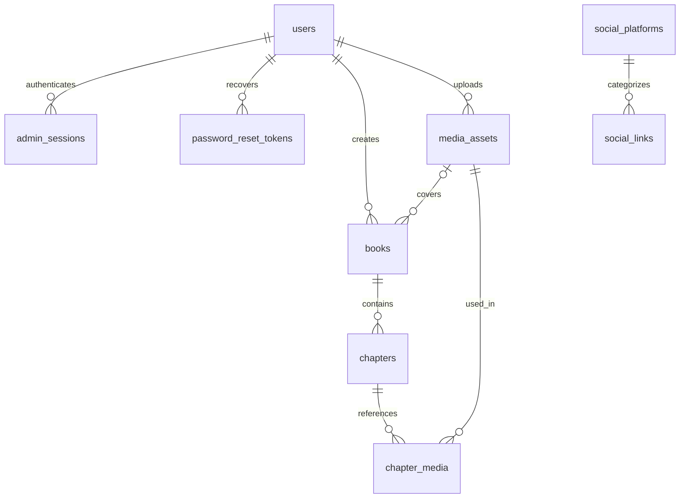

# Bijuverse database and content-management plan

Date: 2026-10-13
Status: proposed implementation plan; user requirements recorded below are confirmed. No database, authentication, storage service, or editor is implemented by this document.
Scope: React frontend first, one module at a time. Neither Express nor Laravel is selected. The previous Laravel stack notes are superseded. Backend framework, database engine, and hosting remain open; this relational model is suitable for PostgreSQL or MySQL with engine-specific migration details decided later.

## 1. Confirmed requirements

- One client/admin account in a users table, signing in with email and password.
- No public registration, visitor accounts, or public login links.
- A custom secret login route. The admin cannot delete their own account; there is no user-deletion feature.
- Admin-managed social links, with a platform selector containing common platforms and support for other websites.
- The same social records supply navbar, footer, and any dedicated social section.
- The admin can create multiple books and create/edit chapters within each book. The original 6–7 chapters are initial content, not a database limit.
- A free rich-text editor with formatting and multiple images positioned throughout the chapter.
- Preserve the earlier portfolio scope: projects/videos, artwork, moderated public reviews, contacts, view analytics, and SEO management.
- Confirmed refinement: reviews belong to individual books, artworks, or projects and share one reviews table and moderation workflow. Visitors do not need accounts. The public label may be Comments; chapter-specific feedback is not currently requested.
- Continue module by module. This task records the data design; it does not start a backend build.

## 2. Keep the implementation manageable

Use one relational database, one media library, one chapter editor, and one admin application. All content belongs to the same portfolio, so do not introduce multi-tenancy, subscriptions, complex roles, or separate databases per module.

Build the first nine tables below for admin access, social links, books, chapters, and media. Add the remaining portfolio tables when their modules are built. Store image files in persistent object storage or persistent server storage; keep metadata and storage keys in the database, not image blobs or base64 text. Storage and hosting may cost money even when the editor has no license fee.

## 3. Table conventions

- Content IDs: UUIDs generated by the server; users uses the fixed singleton ID described below. Foreign keys must use matching types.
- All mutable records have created_at and updated_at timestamps in UTC. Token/session timestamps have the narrower definitions below.
- Fields are required unless marked nullable. Defaults are explicit below.
- Slugs are lowercase URL-safe identifiers. Enforce uniqueness in the database, not just form validation.
- Foreign keys use RESTRICT by default. Hard deletion of referenced media or the admin is forbidden.
- status values are constrained strings; positive numbers and enum-like values get database checks.
- Public APIs select explicit public fields. Never return entire admin rows.

## 4. Initial schema

### users

| Field | Type / rule |
| --- | --- |
| id | Small integer primary key; CHECK id = 1 |
| name | String, max 100 |
| email | String, max 254; normalized; unique case-insensitively |
| password_hash | String; generated by a vetted password-hashing implementation, never plaintext |
| last_login_at | Timestamp, nullable |
| password_changed_at | Timestamp, nullable |
| created_at, updated_at | Timestamps |

The fixed primary key and CHECK enforce at most one admin, including concurrent creation attempts. A deployment seed creates that account once from secret environment input. The application DB role has no INSERT, DELETE, or TRUNCATE privileges on users; migrations/seeding use a separate privileged role. Use a database delete guard as additional protection if the chosen hosting supports it. No application endpoint creates/deletes users or changes the ID. These controls protect the application account; a database owner can still perform maintenance.

Exactly one account after provisioning = seed + singleton constraint + deletion prevention. Never put credentials in React source, this plan, Git, or VITE_* variables. Password changes invalidate existing sessions; email changes require reauthentication and verification of the new address.

### admin_sessions

| Field | Type / rule |
| --- | --- |
| id | UUID primary key |
| user_id | FK users.id |
| token_hash | Unique hash of a cryptographically random session token |
| created_at, last_seen_at | Timestamps |
| expires_at | Timestamp; indexed |
| revoked_at | Timestamp, nullable |

Use a Secure, HttpOnly, SameSite cookie over HTTPS. The raw token is never stored in this table or localStorage. Rotate on login, expire sessions, revoke on logout, and enforce server-side authorization on every admin operation. Protect cookie-authenticated writes against CSRF. Prefer the selected backend's maintained session/auth library instead of writing cryptography.

### password_reset_tokens

| Field | Type / rule |
| --- | --- |
| id | UUID primary key |
| user_id | FK users.id |
| token_hash | Unique token hash |
| created_at, expires_at | Timestamps |
| used_at | Timestamp, nullable |

Only the seeded admin email is eligible. Responses must not reveal whether an email exists. Tokens expire, are single use, and are consumed atomically with the password update and session revocation. Rate-limit both login and recovery. Proposed starting policy: five failed login attempts per 15 minutes per account plus per-IP limits; tune without allowing permanent lockout.

### social_platforms

| Field | Type / rule |
| --- | --- |
| id | UUID primary key |
| key | Unique stable string: facebook, discord, other, etc. |
| name | Human-readable display name |
| icon_key | Known frontend icon identifier; generic fallback |
| sort_order | Integer, default 0 |
| is_active | Boolean, default true |

Seed these 15 common choices (a practical starter list, not a researched popularity ranking): Facebook, Instagram, YouTube, TikTok, X, Discord, LinkedIn, GitHub, Twitch, Reddit, Pinterest, Snapchat, Telegram, WhatsApp, and Threads. Seed an additional Other option.

This catalog can grow. Store icon identifiers, never executable markup/SVG supplied by the admin. Unknown icon identifiers render a generic link icon.

### social_links

| Field | Type / rule |
| --- | --- |
| id | UUID primary key |
| platform_id | FK social_platforms.id |
| label | String, max 100; custom label required for Other |
| url | HTTPS URL, max 2048 |
| is_active | Boolean, default true |
| show_in_navbar | Boolean, default true |
| show_in_footer | Boolean, default true |
| show_in_social_section | Boolean, default true |
| sort_order | Integer, default 0 |
| created_at, updated_at | Timestamps |

Multiple links per platform are allowed. Server-side URL parsing rejects credentials, unsupported protocols, and malformed values; do not fetch arbitrary submitted URLs for previews. Render external links with noopener noreferrer. The public query requires an active platform and link, orders by sort_order then id, and filters by placement. Index (is_active, sort_order). No invented links when an official URL is missing.

### media_assets

| Field | Type / rule |
| --- | --- |
| id | UUID primary key |
| uploaded_by | FK users.id |
| storage_key | Unique immutable storage path/key |
| original_name | Display filename, max 255 |
| mime_type | Validated file MIME type |
| size_bytes | Positive integer |
| width, height | Positive integers, nullable for non-images |
| default_alt | String, default empty |
| status | pending, ready, failed; default pending |
| created_at, updated_at | Timestamps |

Initial chapter uploads: JPEG, PNG, WebP; proposed limit 10 MB and 25 megapixels per image, validated server-side by decoding actual file content. Generate safe filenames and optimized derivatives. Reject executable files and raw SVG/HTML uploads in this initial flow. Limit concurrent uploads and retain selected ordering for multi-file insertion. Upload failures leave a retry/remove state; they cannot be published as broken images.

Private storage is the default. Admin previews use short-lived authorized URLs. Public media delivery checks whether an asset is referenced by published content, so draft images are not exposed by a guessable URL. Never save expiring signed URLs in chapter JSON. Upload and file deletion use retryable operations because file storage and database transactions are separate systems.

### books

| Field | Type / rule |
| --- | --- |
| id | UUID primary key |
| created_by | FK users.id |
| title | String, max 200 |
| slug | Unique string, max 220 |
| synopsis | Plain text, nullable |
| cover_media_id | FK media_assets.id, nullable |
| status | draft, published, archived; default draft |
| sort_order | Integer, default 0 |
| published_at | Timestamp, nullable |
| created_at, updated_at | Timestamps |

A book can contain any number of chapters. Public listings show only published books. Archive a book to hide its chapters from public access too. No automatic cascading destruction of books/chapters. Published metadata edits take effect when explicitly saved; do not autosave the book form in v1. Keep published slugs stable in v1 to avoid adding redirect management immediately.

### chapters

| Field | Type / rule |
| --- | --- |
| id | UUID primary key |
| book_id | FK books.id |
| title | Draft title, max 200 |
| slug | Stable chapter URL identifier, max 220 |
| chapter_number | Positive integer, unique within book |
| sort_order | Integer; order by this then chapter_number |
| draft_content_json | Validated editor document |
| published_snapshot_json | Nullable snapshot: title, editor document, schema version, word count |
| editor_schema_version | Positive integer, default 1 |
| status | draft, published, archived; default draft |
| draft_version | Integer, default 1, for optimistic concurrency |
| published_at | Timestamp, nullable |
| created_at, updated_at | Timestamps |

Constraints: UNIQUE(book_id, slug), UNIQUE(book_id, chapter_number). Index (book_id, status, sort_order). A published row must contain a published snapshot. Existing publication remains visible while draft edits are saved; public queries read only the snapshot, never draft_content_json or draft title. Publishing copies the validated draft into the snapshot in one transaction. Draft_version comparisons reject stale autosaves from another tab instead of silently overwriting text.

Book ownership and URL identity are fixed for existing published chapters in v1. Reordering is an explicit transaction; chapter numbers remain independent of sort_order. Word count and reading time are derived by the server from text nodes, excluding image metadata. Do not store chapter_count as a second source of truth; calculate it from visible chapters.

### chapter_media

| Field | Type / rule |
| --- | --- |
| chapter_id | FK chapters.id |
| media_id | FK media_assets.id |
| usage_scope | draft or published |
| primary key | (chapter_id, media_id, usage_scope) |

This table tracks asset references for deletion protection and media access. JSON determines image position, sizing, caption, and per-occurrence alt text. The same image may appear more than once without duplicate relation rows. The server derives this table from validated JSON, replacing the matching scope in the same save/publish transaction. Clients do not independently maintain it. Index media_id for reference checks.



## 5. Rich-text editor and image positioning

Recommendation: Tiptap open-source core, React integration, StarterKit, Image, and selected free extensions. Build the anime-themed toolbar ourselves. Do not introduce paid collaboration, AI, conversion, or cloud editor services. Lexical is a free alternative, but this project's proposed Tiptap approach already maps well to chapter documents and image nodes; no need to implement both.

Toolbar scope: paragraphs, H2/H3 headings, bold, italic, underline, strike, ordered/bullet lists, quotes, links, scene-break divider, text alignment, undo/redo, image insertion, alt text/caption, and desktop/mobile preview. The chapter title supplies H1 outside the document.

Image behavior: upload several files, select existing media, insert at the text cursor or between paragraphs, move images between blocks, choose alignment and responsive width, add captions, replace or remove an occurrence. Removing an occurrence does not delete the shared file. Images can appear throughout the story instead of being confined to a gallery at the end. Use document flow rather than arbitrary x/y canvas coordinates so mobile reading remains usable. Inline-with-text images can be added if genuinely needed; block images throughout prose are the default.

Tiptap supplies an editor foundation, not our complete CMS. Image uploads, storage, media selection, publication, and reference tracking need application code. A custom image node stores mediaId plus presentation attributes; the editor/public renderer resolves that ID to an authorized URL. Exact extension package versions will be checked when installed; no packages are added during planning.

Example planned document shape (custom image schema):

```json
{
  "type": "doc",
  "content": [
    { "type": "paragraph", "content": [{ "type": "text", "text": "The chapter begins here." }] },
    { "type": "image", "attrs": { "mediaId": "uuid-of-upload", "alt": "A village beside the river", "caption": "At the edge of the village", "align": "center", "widthPercent": 100 } },
    { "type": "paragraph", "content": [{ "type": "text", "text": "Continue the story below the image." }] }
  ]
}
```

Persist structured JSON as the source of truth. Validate allowed node types, marks, attributes, URL protocols, document depth/size, and referenced ready media on the server. Render with a controlled node-to-component renderer; if exporting/rendering HTML, sanitize it. Never trust pasted HTML or arbitrary styles. Keep schema versioning so future editor changes can migrate old chapters.

## 6. Admin and public flows

1. Provision the sole admin securely. They visit the configured login path and enter email/password.
2. Create a book with title, synopsis, and optional cover.
3. Add a draft chapter; write and insert images where wanted.
4. Autosave after a short typing pause, showing Saving/Saved/Failed. Unsaved navigation warns; pending uploads prevent publication. Preview uses the draft with admin authorization.
5. Publish explicitly. Validate the document and all media, replace the published snapshot/references atomically, and invalidate the relevant public cache.
6. Readers see only published books and chapters at /books/:bookSlug and /books/:bookSlug/chapters/:chapterSlug. My Work includes book cards. The existing /work/house-of-the-whirlpool route can link/redirect to the canonical book route when this module ships.
7. Edit a published chapter without changing its live snapshot until Publish changes is clicked.
8. Archive to hide content; retain it for restoration. Delay permanent content deletion in v1. Media deletion is blocked while any draft/published chapter, cover, artwork, project, or SEO record references it. Unreferenced uploads can be reviewed and removed later; no aggressive automatic cleanup initially.

Secret routes are a discoverability measure, not authentication. Configure login, recovery, and admin base paths on the server; public menus never link to them. Unauthenticated admin page/data requests return a generic 404; the login/recovery entry points remain reachable. A separate admin bundle can avoid including admin screens in public navigation code, but real security always comes from server-side sessions and authorization. Static frontend routing alone cannot enforce this requirement. No credentials or real secret path values belong in this file.

## 7. Remaining portfolio tables, added with their modules

| Table | Proposed fields beyond id/timestamps | Rules |
| --- | --- | --- |
| projects | title, slug, description, category, cover_media_id FK, external_url nullable, video_media_id FK nullable, status, sort_order | Unique slug; published-only public access; validate URLs; books stay in books instead of duplicate project rows |
| artworks | title, slug, description, category, status, sort_order | Unique slug; dedicated artwork records |
| artwork_media | artwork_id FK, media_id FK, sort_order, alt_text | Composite PK; supports multiple images per artwork |
| reviews | book_id FK nullable, artwork_id FK nullable, project_id FK nullable, name, rating nullable, comment, status, moderated_at nullable, moderated_by FK users.id nullable | Exactly one target FK populated; rating absent or 1–5; pending/approved/rejected; public sees approved only; no visitor user_id required |
| contacts | name, email, subject, message, status, responded_at nullable | new/read/replied/archived; admin-only; storing a reply state is not email delivery |
| seo_settings | page_key, title, description, og_title, og_description, og_media_id FK nullable, canonical_url nullable, noindex | Unique page_key; default home row; render initial share metadata through the eventual hosting architecture |
| view_counts_daily | date, project_id FK nullable, artwork_id FK nullable, book_id FK nullable, chapter_id FK nullable, count | Exactly one FK populated; unique day/target constraints using engine-appropriate indexes; atomic increments |

Use per-session/time-window deduplication and rate limits before incrementing view counts; don't count every render or autosave. A short-lived shared store can support deduplication/rate limits without introducing a permanent visitor-profile table. Total views are sums of daily counts. Final analytics storage is deferred until the analytics module.

No public likes, payments, reader accounts, threaded replies, or collaborative authoring in the initial implementation. Item reviews/comments and contact forms remain account-free. Their submission endpoints need server-side validation and spam controls.

## 7.1 Shared item reviews/comments — confirmed scope refinement

Use one `reviews` table for all three item types; do not create book_reviews, artwork_reviews, and project_reviews tables. Books, artwork, and projects keep their own content tables because their fields and behavior differ. Only their feedback structure is shared.

| Field | Type / rule |
| --- | --- |
| id | UUID primary key |
| book_id | Nullable FK books.id, ON DELETE RESTRICT |
| artwork_id | Nullable FK artworks.id, ON DELETE RESTRICT |
| project_id | Nullable FK projects.id, ON DELETE RESTRICT |
| name | Visitor display name, trimmed string, 1–100 characters |
| rating | Nullable integer; CHECK rating IS NULL OR rating BETWEEN 1 AND 5 |
| comment | Plain text, trimmed, 1–3000 characters |
| status | pending, approved, rejected; default pending |
| moderated_by | Nullable FK users.id |
| moderated_at | Nullable timestamp |
| created_at, updated_at | UTC timestamps |

Require exactly one non-null target with a database CHECK equivalent to:

```sql
CHECK (
  (CASE WHEN book_id IS NOT NULL THEN 1 ELSE 0 END) +
  (CASE WHEN artwork_id IS NOT NULL THEN 1 ELSE 0 END) +
  (CASE WHEN project_id IS NOT NULL THEN 1 ELSE 0 END) = 1
)
```

Example: a review for The House of the Whirlpool sets book_id, leaving artwork_id and project_id null. An artwork review sets only artwork_id. Separate foreign keys give real database referential integrity. Avoid a generic target_type/target_id pair in this small fixed scope because an ordinary foreign key cannot validate one ID against three different tables. If many new content types arrive later, revisit a shared content entity rather than adding an unneeded abstraction now.

Indexes: (book_id, status, created_at), (artwork_id, status, created_at), (project_id, status, created_at), plus (status, created_at) for the admin queue. Apply engine-specific partial-index optimizations only if useful. No uniqueness constraint on display name: anonymous names do not establish visitor identity.

Submission and moderation:

1. Each published item's detail page loads its own approved feedback and renders a reusable review/comment form with the current item as its target.
2. Visitor supplies name and message; retain rating support from the original review scope. Whether the public form requires stars or presents message-only Comments is a UI choice still to confirm, so the schema permits a null rating.
3. Server validates that the target exists and is published, verifies exactly one target, and creates a pending submission. Ignore/reject client-supplied status, moderation fields, timestamps, or admin IDs.
4. Confirm receipt with an awaiting-approval message. Do not place pending feedback in the public list.
5. One admin queue shows target type/title and allows approval or rejection. Record moderator and time. Public requests can never moderate or retarget a submission.
6. Public lists and counts filter both status=approved and parent publication state. Archiving an item hides its feedback without deleting it. Republished items can show their previously approved feedback again.
7. Compute item rating averages from approved, non-null ratings only; show no rating yet when there are none. Count approved messages separately so unrated comments do not distort averages. Invalidate feedback/count caches after moderation or parent visibility changes.

Names/messages are unverified visitor submissions. No email, password, or visitor account is required. Escape message text; do not accept rich HTML in visitor feedback. Apply bounded pagination, request-size limits, and server-side per-IP/session throttling. Do not pretend anonymous users can be reliably limited to one review per person. Reviews of chapters, general site feedback, replies, and guest editing/deletion are deferred until explicitly requested.

Acceptance checks: submissions cannot target zero or multiple items; nonexistent/draft targets are rejected; one book's feedback never appears on another item; pending/rejected messages are not public; only the admin can approve; archived targets hide approved messages; null ratings do not enter averages; escaped text cannot execute scripts.

## 8. Implementation sequence and acceptance checks

1. Confirm hosting/backend when backend work starts; create engine-specific migrations and seed the sole admin/platform catalog.
2. Build admin login/session/recovery; test a second-user insert and admin deletion are rejected, unauthorized operations fail, expired tokens fail, and no registration endpoint exists.
3. Build Social Links CRUD once; verify navbar/footer both use it and unknown platforms receive the fallback icon.
4. Build media upload/library and Books CRUD.
5. Build chapter editor, autosave, preview, publication, and media-reference transactions. Test stale-tab saves, failed uploads, repeated image use, draft edits remaining private, and in-use file deletion being blocked.
6. Build public book/chapter reader and previous/next navigation, including direct links, responsive images, unpublished-parent protection, and empty books.
7. Add other portfolio modules independently. Back up both database and uploaded files; perform a restore check before launch.

Optional later improvements: revision history with restore, scheduled publishing, redirects for changed slugs, and media optimization jobs. Do not buy paid editor features for this scope.

## 9. Reference material checked on 2026-10-13

- Tiptap open-source repository and license: https://github.com/ueberdosis/tiptap
- Tiptap Image extension (block/inline images, resizing; upload behavior is separate): https://tiptap.dev/docs/editor/extensions/nodes/image
- Tiptap FileHandler (drop/paste hooks requiring application handling): https://tiptap.dev/docs/editor/extensions/functionality/filehandler
- Lexical alternative: https://lexical.dev/docs/intro and https://github.com/facebook/lexical

The schema, workflow, limits, and editor choice above are project design proposals, not claims that these features already exist in the current frontend.
